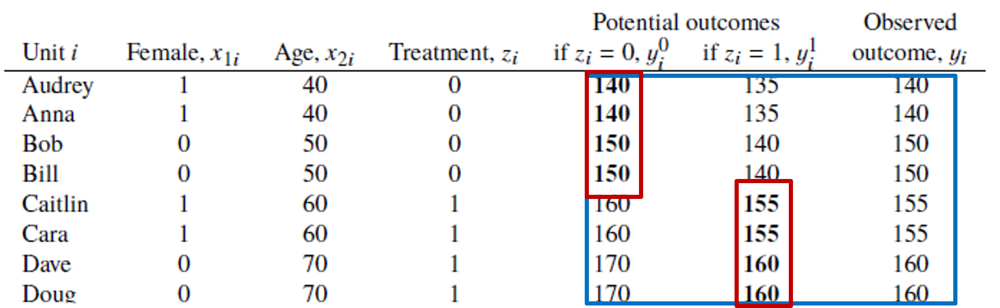
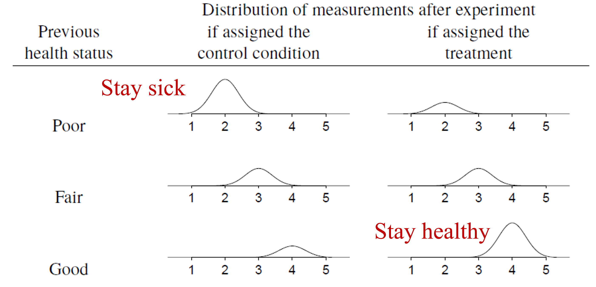

## Learning Objectives

::: incremental
1. Distinguish prediction from causation
2. Define causal effects using potential outcomes
3. Explain the fundamental problem of causal inference
4. Identify confounders, mediators, and colliders
5. Interpret DAGs
6. Recognize causal estimands (ATE, ATT, CATE)
7. Understand why identification strategies are needed
8. Connect causal inference to transportation choice modelling
:::

## Causal Inference in Transportation Planning
- Large-scale transportation models principally concerned with prediction
- However, increasingly interested in policy interventions & treatments

## Need for Causal Inference - Interpretation
- People are told to run around in a dark room for 5 minutes
- **Observation**: Men are found to have many more head injuries than women
- Potential causal conclusions: 
    - Women see better in the dark? 
    - Men are more reckless runners?

## Need for Causal Inference - Unobserved Heterogeneity
- Women who smoke have babies that are 600 grams under weight on average
- **Problem**: 
    - Is it due to smoking or unobserved factors that are correlated with smoking?

## Need for Causal Inference – Endogeneity & Self-Selection
- Cars with side impact airbags have lower injury severities when involved in crashes
- **Problem**: 
    - People owning side-impact airbags are not a **random sample** from the population (likely safer drivers)
    - Safter drivers expected to have lower injury severities

## Need for Causal Inference – Endogeneity & Self-Selection
- People who take motorcycle safety courses have higher crash rates
- **Problem**: 
    - Are courses ineffective?
    - People taking the course are not a random sample from the population (possibly less skilled)

## Need for Causal Inference - Endogeneity & Self-Selection
::: incremental
- Does living near transit increase transit use? (Yes, No, Cannot tell)
- What evidence would convince you?
:::

## Transportation Questions - Which are causal? {.smaller}

| Question                                | Predictive or Causal? |
| --------------------------------------- | --------------------- |
| Who rides transit?                      | <span class="fragment">Predictive</span> |
| Who buys EVs?                           | <span class="fragment">Predictive</span> |
| Does rail access increase transit use?  | <span class="fragment">Causal</span> |
| Will congestion pricing reduce driving? | <span class="fragment">Causal</span> |
| Does carbon labeling induce downsizing? | <span class="fragment">Causal</span> |

- Policy problems are often causal
- Choice modelling typically used on prediction tasks in transportation
- How to integrate casaul inference in choice modelling?

## Causation = Potential Outcomes
- A key concept in causal inference is **potential outcomes**
- What happened vs. what could have happened (**counterfactual states**)
- We will work with the home location example to illustrate the principles…

## Potential Outcomes Framework {.smaller}
- Consider household $i$ with treatment $T_i = \{0,1\}$ representing their potential home location state
    - $T_i = 1$ means they live near a rail station
    - $T_i = 0$ means they do not live near a rail station
    - $Y_i$ is the outcome of interest - e.g., transit trips per week
- Potential outcomes are $Y_i(1) = \text{ Trips given live near rail station}$ and $Y_i(0) = \text{ Trips given do not live near rail station}$
- Individual causal effect is then $\tau_i = Y(1) - Y(0)$
- Can we observe both outcome states for a single individual?

## Fundamental Problem of Causal Inference {.smaller}
- We observe $Y_i = T_iY_i(1) - (1-T_i)Y_i(0)$ but never both outcomes
- **Causal inference is fundamentally a missing data problem**

| Household | Treatment | Outcome |
| --------- | --------- | ------- |
| A         | 1         | 15      |
| B         | 0         | 7       |
| C         | 1         | 12      |

- What is Household A's causal effect?

## Causal Experiment Design
- **Randomized controlled trials** are “gold standard”
- **Almost never available** for transportation/social science research questions
- What to do?

## Adjustment for Pretreatment Variables
- Differences between treatment & control variables can be captured by including **pretreatment variables** in the model
- Addresses both random (**variance**) and systematic (**bias**) differences between treatment & control
- **Do not** adjust for posttreatment variables unless performing more complex analysis – e.g., instrumental variables (**IV**)

## Ignorability Condition
- **Ignorability in causal inference**: no imbalance between treatment & control, on average
- **Assignment to treatment** does not imply anything about potential outcome

## Average Causal Effects {.smaller}
- Average treatment effect
$$ATE = E[Y(1)-Y(0)]$$
    - **Interpretation:** Average effect in the population
- Average treatment effect on treated
$$ATT = E[Y(1)-Y(0)\mid T=1]$$
    - **Interpretation:** Average effect for those receiving treatment
- Conditional average treatment effect
$$CATE(x) = E[Y(1)-Y(0)\mid X=x]$$
    - **Interpretation:** Average treatment effect given mediation variable value (connection to heterogeneity)

## Transportation examples

| Estimand | Example                               |
| -------- | ------------------------------------- |
| ATE      | Average effect of rail station proximity on transit use  |
| ATT      | Effect of rail station proximity on households actually exposed |
| CATE     | Effect of rail station proximity by income group                |

- Heterogeneous treatment effects = taste heterogeneity = random coefficients

## Why Correlation Fails {.smaller}
::: {.columns}

::: {.column width="60%"}
- Observed relationship:
```{mermaid}
flowchart LR
    A["Lives Near Transit"] --> B["Transit Use"]
```
- Introduce preferences:
```{mermaid}
flowchart TB
    P["Transit Preference"]
    P --> N["Lives Near Transit"]
    P --> T["Transit Use"]
```
:::
::: {.column width="40%"}
- Association is **confounded**
- **Confounder** is a variable that affects both that affects both the treatment \& outcome
- **Interpretation:** people who like transit choose transit-oriented neighbourhoods \& people who like transit ride it more
- Observed association may arise from preferences not treatment effect 
:::
:::

# Directed Acyclic Graphs (DAGs)
# Representing Causal Inference Via DAGs {.smaller}
- Visual representation of assumptions
- More complex confounder example:
```{mermaid}
flowchart TB
    P["Transit Preference"]
    I["Income"]
    D["Downtown Employment"]
    P --> N["Lives Near Transit"]
    P --> T["Transit Use"]
    I --> N
    I --> T
    D --> N
    D --> T
```
- Controlling for confounders (next lecture: via propensity scores, etc.):
```{mermaid}
flowchart LR
    N["Lives Near Transit"] --> T["Transit Use"]

    P["Transit Preference"]
    P -. Controlled For .-> N
    P -. Controlled For .-> T
```

## Mediator Variables {.smaller}
- Suppose transit proximity changes vehicle ownership
```{mermaid}
flowchart LR
    N["Lives Near Transit"]
    C["Car Ownership"]
    T["Transit Use"]
    N --> C
    C --> T
```
- **Interpretation:** living near transit may reduce (mediate) car ownership, which then increases transit use
- Can capture $\text{Total effect} = \text{Direct effect} + \text{Indirect effect}$
```{mermaid}
flowchart LR
    N["Lives Near Transit"]
    C["Car Ownership"]
    T["Transit Use"]
    N --> T
    N --> C
    C --> T
```

## Collider Variables {.smaller}
- Suppose we only have information on households who recently moved
```{mermaid}
flowchart TB
    P["Transit Preference"]
    H["Housing Affordability"]
    P --> M["Recently Moved"]
    H --> M
    P --> T["Transit Use"]
```
- If we condition on movers, we inadvertently create an association between transit preference \& housing affordability
```{mermaid}
flowchart TB
    P["Transit Preference"]
    H["Housing Affordability"]
    P --> M["Recently Moved"]
    H --> M
    P --> T["Transit Use"]
    M:::highlight
    classDef highlight fill:#ffd9a8
```

## Final Summary DAG {.smaller}
:::{columns}
::: {.column width="50%"}
```{mermaid}
flowchart TD
    Q["Causal Question"]
    PO["Potential Outcomes"]
    DAG["Causal Graphs"]
    ID["Identification Strategy"]
    EST["Effect Estimation"]
    Q --> PO
    Q --> DAG
    PO --> ID
    DAG --> ID
    ID --> EST
```
:::
::: {.column width="50%"}
- DAGs tell us **what assumptions are needed**
- Potential outcomes tell us **what quantity we want to estimate**
- Identification strategies tell us **how to estimate it**
- **Confounders:** We control for them because they capture associations that exist
- **Colliders:** We avoid controlling for them because they create associations that do not exist
:::
:::

# Additional Causal Inference Details
## Simpson's Paradox {.smaller}
- Issue of inference on aggregate \& disaggregate data
- Suppose we observe the following aggregate data

| Neighborhood | Transit Share |
| ------------ | ------------: |
| TOD          |           40% |
| Non-TOD      |           20% |

- Now stratify by transit preference

:::{columns}
::: {.column width="50%"}
People who prefer transit

| Neighborhood | Transit Share |
| ------------ | ------------: |
| TOD          |           80% |
| Non-TOD      |           85% |
:::
::: {.column width="50%"}
People who prefer driving

| Neighborhood | Transit Share |
| ------------ | ------------: |
| TOD          |           10% |
| Non-TOD      |           15% |
:::
:::

## Simpson's Paradox {.smaller}
- Within both groups, transit use is actually **lower** in TODs
- Why? Transit enthusiasts disproportionately choose TODs
- E.g.,
| Group               | TOD | Non-TOD |
| ------------------- | --: | ------: |
| Transit enthusiasts | 90% |     10% |
| Drivers             | 10% |     90% |

- **Problem:** aggregate comparison is mostly comparing transit enthusiasts against drivers (not TOD against non-TOD) - confounding with transit preference! 
- Simpson's paradox is what happens when we compare the wrong groups 

## Causal Inference Example: Omega-3 Fatty Acids {.smaller}
**Problem**: Does consumption of omega-3 fish oil supplements promote a healthy blood pressure?

**Experiment**: Eight friends agree to be part of an informal study on the relationship between fish oil supplements and systolic blood pressure. Four of the friends are placed in the “fish oil supplement” **treatment group**. Members of this group agree to consume 3 grams of fish oil supplements per day for one year while otherwise maintaining their current diets. The other four friends agreed to simply maintain their current diets free from fish oil supplements for the same year. At the end of the study period:

- Measure blood pressure
- Assume 160 mmHg and above represents “high blood pressure”

## Formal Problem Statement {.smaller}
$$𝑧 = 0 \text{; no fish oil supplement}$$
$$𝑧 = 1 \text{; fish oil supplement}$$

- Need to consider two cases:
    - Blood pressure given a person **did not** ingest any fish oil supplement $(y_i^0)$
    - Blood pressure given a person **did** ingest fish oil supplement $(y_i^1)$
- Only ever observe **one outcome per person** – no time machines!

## Formal Problem Statement
- Treatment given by $T_i = y_i^1 - y_i^0$
- **Fundamental problem of causal inference**: cannot observe both $y_i^1$ and $y_i^0$
- Can only estimate average causal effect across a sample (population)

## Close Substitutes
- What about using pre-study blood pressure as $𝑦_𝑖^0$?
    - Do not know if person made other changes over the year
- What about using post-study blood pressure as $𝑦_𝑖^0$?
    - Do not know if treatment has effect into year 2

## Average Treatment Effects {.smaller}
- Start with treatment and control groups
- Need sufficiently similar groups – balance
- Beware self-selection bias
{fig-align="center"}
- True average treatment effect = -7.5 mmHG
- Average treatment effect|treatment = +12.5 mmHG

## Health Status Example
- Consider 100 patients receive a treatment and 1000 receive the control condition
- **Causal truth**: treatment has zero effect on health outcomes
- Suppose treatment and control groups **systematically differ**, with healthier patients receiving treatment

## Health Status Example
{fig-align="center"}

## Adding Predictors: Omitted Variables
- Simple solution is to compare treated and control units **conditional on previous health status**
- Health status is a **confounding variable** – affects both treatment & outcome
- If all confounding variable observed, then consistent causal treatment is possible

## Omitted Variable Bias {.smaller}
- Correct specification:
$$y_i = \beta_0 + \beta_1 𝑧_𝑖 + \beta_2 x_i + \epsilon_𝑖$$
- where $𝑧_𝑖$ is the treatment and $𝑥_𝑖$ is the covariate for unit $i$
- If $𝑥_𝑖$ is ignored then:
$$𝑦_𝑖=\beta_0^∗+\beta_1^∗ 𝑧_𝑖+\epsilon_𝑖^∗$$
- Using $𝑥_𝑖=\gamma_0+\gamma_1 𝑧_𝑖+𝜈_𝑖$:
$$𝑦_𝑖=\beta_0+\beta_2 \gamma_1+(\beta_1+\beta_2 \gamma_1 ) 𝑧_𝑖+\epsilon_𝑖+\beta_2 𝜈_𝑖$$
- Then:
$$\beta_1^∗=\beta_1+\beta_2 \gamma_1 \text{; }\gamma_1=0 \text{ denotes a non-confounding variable}$$

## Ignorability in Observational Studies {.smaller}
- **Strict ignorability** says distribution of potential outcomes same across treatment levels:
$$𝑦^0,𝑦_1 \perp 𝑧$$
- Conditional ignorability says the distribution of potential outcomes across treatment levels is the same, conditional on the covariates, $x$:
$$𝑦^0,𝑦_1 \perp 𝑧|𝑥$$
- Must make “leap of faith” that we have conditioned on all necessary confounding variables – **selection on observables** in econometrics literature

## Common Support or Overlap
{fig-align="center"}