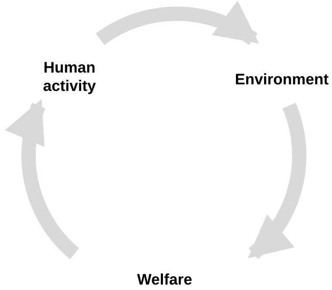
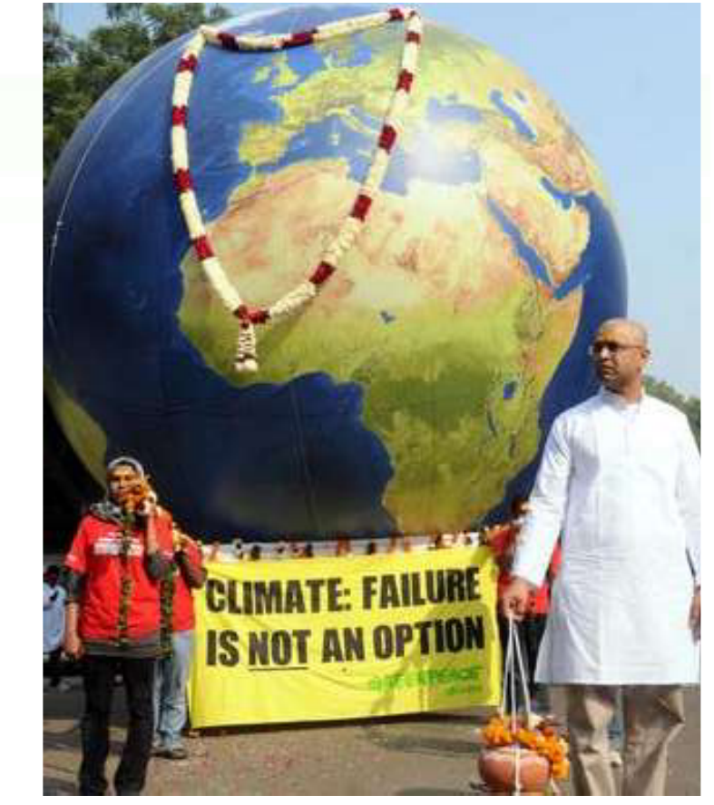
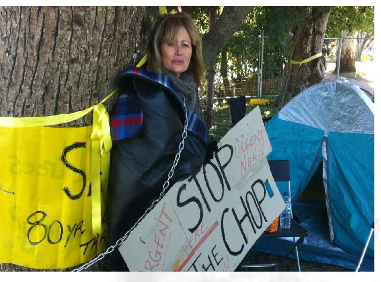
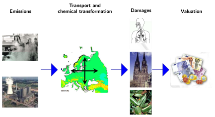
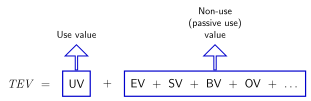
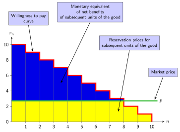
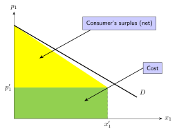
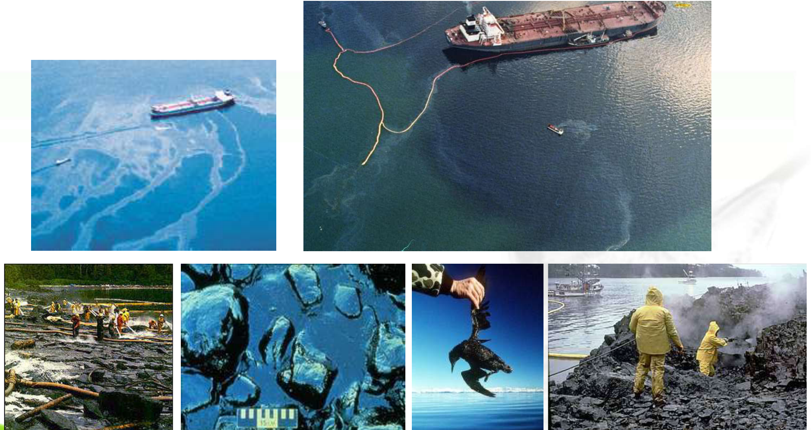

## Outline

::: incremental
1. Motivation for valuation
2. Individuals' motivation for willingness to pay (WTP)
3. Economic theory
4. Nonmarket valuation methods
5. Short history of contingent valuation
:::

## Why Economic Valuation?
- Rational decisions with respect to the environment

:::: {.columns}

::: {.column width="45%"}

:::

::: {.column width="55%"}
- Market inefficiency: public goods (CBA) & externality effects (Pigouvian tax)
- Assessing economic desirability of a policy
  - Demonstrate importance of the issue
  - Priority setting
- Legal damage assessment
- Green national accounting
- The least controversial argument

:::

::::

## Why Economic Valuation?

::: {layout="[[50,50],[50]]" layout-valign="center"}
{fig-alt="Climate campaigners with a giant inflatable globe and a banner reading 'Climate: failure is not an option'"}

{fig-alt="Protester chained to a tree next to a tent with a 'Stop the chop' sign"}

{fig-alt="Greenpeace activists unrolling a banner down a building facade"}
:::

## Environmental Decision Making

Environmental changes affect:

- Human welfare
- Economic activity
- Public goods
- External effects

Applications:

- Cost-benefit analysis
- Environmental policy evaluation
- Priority setting
- Legal damage assessment
- Green national accounting

## Cost-Benefit Analysis

A complete CBA should:

- Compare all costs and benefits
- Include environmental and health impacts
- Quantify environmental changes
- Value those changes monetarily
- Calculate net benefits
- Account for discounting
- Compare alternatives
- Support decision-making

# Example: Electricity Generation

## The Problem

How harmful are different ways of generating electricity?

Electricity production generates:

- Air pollution
- Greenhouse gases
- Health impacts
- Ecosystem damage

These external effects are often not reflected in market prices (or in power plants' economic decisions).

Economic theory suggests:

- Taxing emissions according to marginal external damage
- Comparing technologies based on social costs

Which energy sources should be promoted?

## The ExternE Approach

Major European research efforts ([www.externe.info](http://www.externe.info)):

- ExternE
- ExternE-Pol (2002–2004)
- NEEDS (2004–2008)
- CASES (2006–2008)
- EXIOPOL (2007–2011)

Goal:

Estimate the average external costs of electricity generation

- Bottom-up approach: damages for each power plant depend on local conditions
  - Technology, fuel, location, atmospheric conditions

# Impact Pathway Approach

## Valuation Process

1. Emissions released (where, what, how)
2. Atmospheric transport
3. Chemical transformations (reactions with other pollutants)
4. Concentration changes
5. Physical impacts
6. Welfare impacts
7. Monetary valuation

Damages are then recalculated per unit of energy.

## Impact Pathway

{fig-alt="Impact pathway: emissions from cars and power plants, transport and chemical transformation across Europe, damages to health, buildings and crops, then valuation in money"}

## Step 1: Concentration Increase

![Additional SO~2~ concentration caused by the Lauffen coal-fired power plant [µg/m³]. © IER Universität Stuttgart](../../../assets/images/teaching/ENCI707/Lecture12/so2-concentration.png){fig-alt="Map of Europe showing additional SO2 concentration from the Lauffen plant, highest in southern Germany"}

## Step 2: Exposed Population

![Population density [millions]. © IER Universität Stuttgart](../../../assets/images/teaching/ENCI707/Lecture12/population-density.png){fig-alt="Gridded map of population density across Europe"}

## Step 3: Physical Impact

![Cumulative life years lost from increased SO~2~ concentrations caused by the Lauffen plant [years annually]. © IER Universität Stuttgart](../../../assets/images/teaching/ENCI707/Lecture12/life-years-lost.png){fig-alt="Map of Europe showing life years lost, concentrated around southern Germany"}

## Step 4: Valuation

We know how many life years are lost in each grid cell in Europe – what next?

- How do we include it in a cost-benefit analysis?
- What is the value of a statistical life (or of a life year lost)?
- Valuation!

# Types of Welfare Effects

## Examples

Health:

- Mortality
- Morbidity

Environment:

- Biodiversity loss
- Acidification
- Eutrophication

Economic:

- Agriculture
- Materials damage

# Why Valuation Matters

## Importance in Practice

Economic valuation:

- Supports major policy decisions
- Appears in tens of thousands of studies
- Is a major part of environmental economics conferences and standard in textbooks
- Is central to welfare economics
- Is used in environment, health, transportation, marketing, and culture

Examples include large regulatory analyses such as the U.S. Clean Water Act (U.S. EPA, 1994), plus many sectoral and regional decisions.

# Sources of Economic Value

## Whose Value?

- [Economic]{.underline} value = consumers' aggregated willingness to pay
  - Based on people's preferences
  - Anthropocentric!
- Motives are essentially irrelevant for the neoclassical theory of value
  - Economists accept consumer sovereignty
  - But this is not to say that motives are irrelevant at all…

## Total Economic Value (TEV)

{fig-alt="TEV equals use value UV plus non-use (passive use) value EV plus SV plus BV plus OV plus more"}

Where:

- UV = Use Value
- EV = Existence Value
- SV = Stewardship Value
- BV = Bequest Value
- OV = Option Value

# Use and Non-Use Values

## Use Value

Benefits obtained from direct or indirect use.

Examples:

- Recreation
- Fishing
- Water consumption

## Non-Use Value

Benefits independent of actual use (also called passive-use value).

Examples:

- Knowing a species exists
- Preserving resources for future generations

## Disentangling Motives

- Different motivations are not mutually exclusive
  - They tend to be positively correlated
- Difficult (if not impossible) to disaggregate
- Use vs. non-use values
  - Non-use values are unlikely to leave a trace in market behavior
  - They require different valuation methods

# Existence Value

## Definition

Utility gained simply from knowing that an environmental resource exists.

> "[…] satisfaction from the mere knowledge that part of the wilderness […] remains, even though they would be appalled by the prospect of being exposed to it."

Examples:

- Endangered species protection
- Wilderness preservation

Individuals may value protection even if they never visit the resource.

# Stewardship Value

## Definition

Value derived from acting as a responsible caretaker – a duty to protect some entity from harm imposed by human activity.

Examples:

- Maintaining water quality
- Preserving habitats / setting land aside rather than developing it
- Preventing human-caused (not natural) species losses

# Bequest and Option Values

## Bequest Value

Protecting resources for future generations.

## Option Value

Maintaining future opportunities for use.

Important when:

- Future preferences are uncertain
- Environmental damage may be irreversible

# Other Motivations

## Altruism

Concern for others' welfare.

Examples:

- Concern for future generations
- Concern for wildlife

Not an illegitimate source of value, but may cause double counting if respondents don't realize that others will pay too.

## Warm Glow

Utility from contributing to a socially desirable cause.

Examples:

- Charitable giving
- Environmental donations (especially voluntary contributions)

# What Is Economic Value?

## Price vs Value

- Price is not necessarily value

- Economic value is linked to:
  - Preferences
  - Welfare
  - Willingness to pay
- Relevant concept is welfare change

## Value of a Market Good

{fig-alt="Step chart of reservation prices r_n for units n = 1 to 10, falling from 10 to 1, with a market price line at about 2.7; area above the price and below the WTP curve is net benefit, area below the price is cost"}

## WTP Curve vs Demand Curve

- The WTP curve is close to the demand curve, but they are not the same
  - WTP curve: WTP for *subsequent* units
  - Demand curve: WTP for *x* units (at once)
  - Differences arise from income effects
- In practice the WTP curve is difficult to estimate
  - The demand curve is used as an approximation → consumer surplus

# Willingness to Pay

## Concept

WTP measures:

> The maximum amount an individual would sacrifice to obtain a benefit or avoid a loss.

WTP is the foundation of modern economic valuation.

# Consumer Surplus

## Basic Idea

Consumer surplus equals:

- What consumers are willing to pay
- Minus what they actually pay

Graphically:

- Area under the demand curve
- Above market price

## Consumer Surplus

{fig-alt="Linear demand curve D; at price p1' and quantity x1' the triangle above the price is consumer's surplus (net) and the rectangle below is cost"}

## Consumer Surplus – an Approximation

- Income effects are not taken into account
- If income effects are present:
  - Marginal utility of income is decreasing (the richer we are, the less we care about money)
  - We need more money for the same utility increase

# Welfare Measures

## Beyond Consumer Surplus

When income effects matter:

### Compensating Variation (CV)

Income adjustment needed after a change to restore original utility (measured ex post).

### Equivalent Variation (EV)

Income adjustment before a change to achieve final utility (measured ex ante).

## CV and EV Formally

- Compensating variation: $U(p, q, m) = U(p, q', m + CV)$
- Equivalent variation: $U(p, q, m - EV) = U(p, q', m)$

Which one is larger?

- $q' > q \Rightarrow EV > CV$
- $q' < q \Rightarrow EV < CV$

If there are no income effects: $EV = CV = CS$

# WTP and WTA

## Property Rights Matter

Two key measures:

- WTP (Willingness to Pay)
- WTA (Willingness to Accept)

Choice depends on:

- Initial entitlement
- Property rights

## Which Is WTP and Which Is WTA?

:::: {.columns}
::: {.column width="50%"}
Improvement, $q' > q$:

$$
\begin{aligned}
U(p, q, m) &= U(p, q', m - WTP) \\
U(p, q, m - WTA) &= U(p, q', m)
\end{aligned}
$$
:::
::: {.column width="50%"}
Deterioration, $q' < q$:

$$
\begin{aligned}
U(p, q, m) &= U(p, q', m + WTA) \\
U(p, q, m - WTP) &= U(p, q', m)
\end{aligned}
$$
:::
::::

# Nonmarket Goods

## Why Special Methods?

Examples:

- Biodiversity
- Water quality
- Recreation sites
- Ecosystem services

These goods often lack market prices.

# Valuation Approaches

## Two Major Families

### Revealed Preference (RP)

Observed behavior in actual (or surrogate) markets.

### Stated Preference (SP)

Choices observed in hypothetical settings, usually in a survey.

The families differ in scope of observed values, flexibility, and reliability.

# Revealed Preference Methods

## Examples

### Productivity Method

Environmental inputs used in production (e.g., water used to produce juice).

### Avoided Damage / Substitute Cost Methods

Value inferred from prevented losses (e.g., flood protection).

### Hedonic Pricing

Property or wage markets.

### Travel Cost Method

Recreation demand and site valuation.

# Hedonic Pricing

## Applications

Examples:

- House prices near lakes
- Air quality impacts on housing
- Labor market risk premiums
- Value of statistical life (airbags, work accidents)
- Ecological attributes of goods (e.g., fair-trade coffee)

Approach:

- Collect market data
- Control for all other attributes of the good
- Statistically isolate environmental effects

# Travel Cost Method

## Applications

Examples:

- National parks
- Urban parks
- Recreation areas

Uses:

- Travel expenses
- Travel time
- Visit frequency

to estimate demand.

# Limitations of RP Methods

## Challenges

- Suitable markets may not exist
- Only observed conditions can be valued
- Limited ability to estimate passive-use values

Often produces lower-bound estimates.

# Stated Preference Methods

## Main Idea

Respondents evaluate hypothetical scenarios; their choices are *contingent* on the scenario posed ⇒ contingent valuation (CV).

Allows valuation of:

- Future policies
- Unobserved outcomes (levels very different from current or past ones)
- Non-use values – SP is the only approach that captures them

Includes:

- Contingent valuation
- Discrete choice experiments

# Contingent Valuation

## Basic Question

Typical format:

> What is the maximum amount you would be willing to pay?

Advantages:

- Simple
- Direct

Challenges:

- Strategic responses
- Hypothetical bias

# Short History of CV

## Origins

- First academic application: Davis (1963) – value hunters and tourists placed on a wilderness area
  - Knetsch and Davis (1966, Resources for the Future) compared CV with the travel cost method
- Early focus on goods with large passive-use value (species, wilderness)
  - Randall, Ives and Eastman (1974) – visibility changes from air pollution in the U.S. southwest
- Water Resources Council (1979): CV one of three acceptable methods for evaluating federal projects
- U.S. EPA research program developing CV (1970s–1980s)

# Early Elicitation Formats

## Historical Approaches

### Bidding Game

Iterative price adjustments: start from an initial amount; increase if yes, decrease if no; continue until the answer changes.

### Open-Ended Questions

Direct WTP response.

### Payment Cards

Respondents select from an array of offered values.

# Problems with Early Methods

## Common Issues

- Starting point bias
- Nonresponse
- WTP/WTA disparity
- Incentive compatibility concerns
- Hypothetical bias

Response: the single binary discrete choice question – different bids randomly assigned to respondents, mirroring markets with posted prices.

# The Exxon Valdez Turning Point

## Exxon Valdez (1989)

{fig-alt="Photos of the Exxon Valdez oil spill: aerial views of the tanker and oil slick, oiled rocks, an oiled seabird, and cleanup crews on the shore"}

## Why It Matters

The oil spill generated:

- Large environmental damages – spectacular scale, but no one directly suffered
- Legal disputes over valuation (estimated damages \$3–15 bln; CV study by Carson et al., 1992)
- Major scrutiny of contingent valuation methods (Exxon-sponsored symposia; Hausman, 1993)

# NOAA Panel Recommendations

## Arrow-Solow Panel

Convened by the U.S. government (Arrow et al., 1993):

> "CVM studies can produce estimates reliable enough to be the starting point of a judicial or administrative determination of natural resource damages, including lost passive values."

Recommendations:

- Use realistic scenarios
- Use referendum-style questions
- Use single binary choice formats
- Emphasize incentive compatibility

These recommendations became highly influential; the number of CV studies grew exponentially, and richer formats (e.g., double-bounded dichotomous choice) kept developing.

# Emergence of Choice Experiments

## Adamowicz, Louviere & Williams (1994)

Respondents choose among alternatives characterized by:

- Multiple attributes
- Different levels

(16 choice sets with 3 alternatives, presented in tables)

Benefits:

- Richer preference information
- Explicit valuation of attributes

Hanley, Wright & Adamowicz (1998) summarized the rapidly growing DCE literature.

# Why DCEs Became Popular

## Advantages

- More information per respondent
- Attribute-level valuation
- Flexible policy analysis
- Closer connection to random utility theory
- Thought to avoid some problems associated with "CV" (and new methods were easier to publish)

Confusion in the literature: 2 alternatives = "CV"; more alternatives or choice situations in a table = "choice experiments".

# Terminology

## Related Terms

Now (Carson and Louviere, 2011), DCE is considered another elicitation format within the CV method.

$$
\left.
\begin{array}{l}
\text{Choice experiments} \\
\text{Stated choice} \\
\text{Choice modelling} \\
\text{Conjoint choice experiments} \\
\text{Contingent rating} \\
\text{Conjoint analysis}
\end{array}
\right\}
\;\longrightarrow\;
\text{Discrete choice experiments (DCE)}
$$

## Summary

- Economic valuation supports environmental decision making.
- Value is based on welfare and preferences.
- Total economic value includes use and non-use components.
- Many environmental goods lack market prices.
- RP and SP methods provide complementary approaches.
- DCEs emerged as a powerful stated-preference method.
