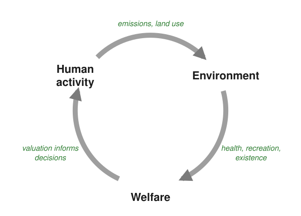
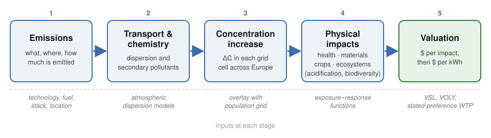
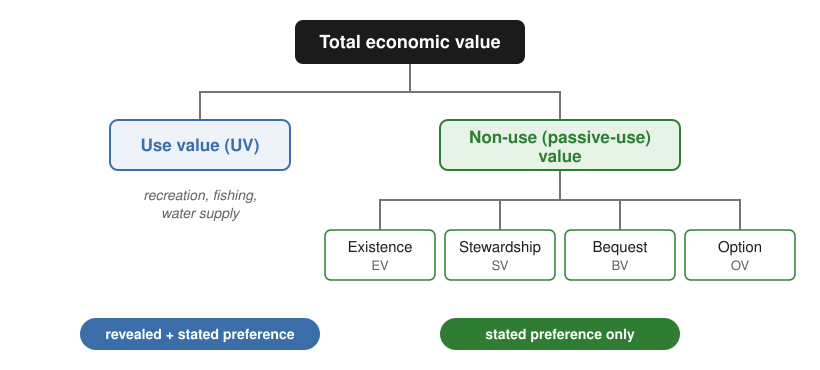
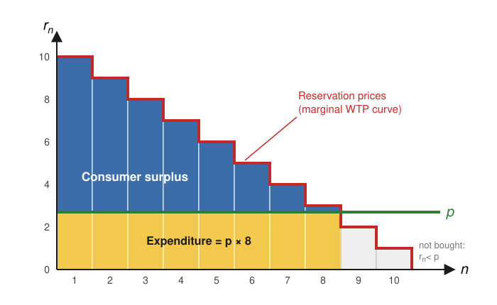
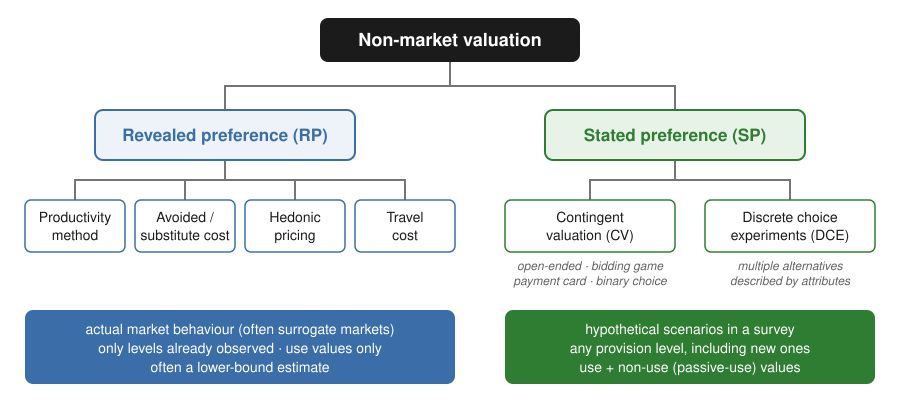
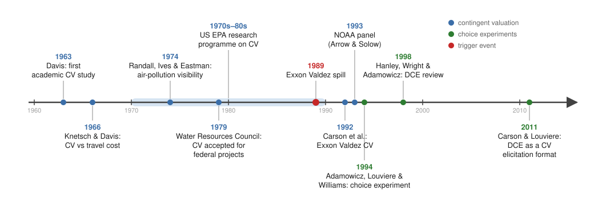

## Outline

::: incremental
1. Motivation for valuation
2. Individuals' motivation for willingness to pay (WTP)
3. Economic theory
4. Nonmarket valuation methods
5. Short history of contingent valuation
:::

# Motivation for Valuation

## Environmental Decision Making {.smaller}

:::: {.columns}
::: {.column width="50%"}
{fig-align="center"}
:::
::: {.column width="50%"}
Valuation supports rational decisions about the environment:

- Market inefficiencies
  - Public goods → cost-benefit analysis
  - External effects → Pigouvian taxes
- Assessing the economic desirability of policies
  - Demonstrating the importance of an issue
  - Priority setting
- Legal damage assessment
- Green national accounting
- Often the least controversial argument
:::
::::

## Basic Cost-Benefit Analysis (CBA) Framework {.smaller}

A complete CBA should:

- Compare all costs and benefits
- Include environmental and health impacts
- Quantify environmental changes
- Value those changes monetarily
- Calculate net benefits
- Account for discounting
- Compare alternatives

## Is Economic Valuation Important? {.smaller}

- Tens of thousands of papers and studies
- A major share of presentations at environmental economics conferences
- Standard material in environmental economics textbooks
- Used to assess very large policies, e.g., the U.S. Clean Water Act (U.S. EPA, 1994)
- ...and a wide range of sectoral and regional policy decisions

Central to modern welfare economics: environment, health, transport, marketing, culture, ...

# Example: Electricity Generation

## The Problem {.smaller}

- How "harmful" are different ways of generating electricity?
- Electricity production generates:
  - Air pollution
  - Greenhouse gases
  - Health impacts
  - Ecosystem damage
- These external effects are not included in the economic decisions of power plants
- Economic theory suggests:
  - Taxing emissions according to marginal external damage
  - Comparing technologies based on social costs: which sources should be promoted?

## External Costs of Electricity {.smaller}

Major European research efforts ([ExternE](https://www.externe.info) project series):

| Project | Years |
|---|---|
| ExternE-Pol | 2002–2004 |
| NEEDS | 2004–2008 |
| CASES | 2006–2008 |
| EXIOPOL | 2007–2011 |

**Goal:** estimate the average external cost of electricity generation

- Bottom-up approach
- Damages from each power plant depend on local conditions: technology, fuel, location, atmospheric conditions

## Impact Pathway Approach

{fig-align="center" width="100%"}

Damages are summed over all receptors, then expressed per unit of energy (\$/kWh)

## Types of Welfare Effects {.smaller}

- Health:
  - Mortality
  - Morbidity
- Environment:
  - Biodiversity loss
  - Acidification
  - Eutrophication
- Economic:
  - Agriculture
  - Materials damage

# Individuals' Motivation for WTP

## Economic Value {.smaller}

- Economic value = consumers' **aggregated willingness to pay**
  - Based on people's preferences
  - Anthropocentric!
- Motives are essentially irrelevant to the neoclassical economic theory of value
  - Economists accept **consumer sovereignty** (i.e., people know what is best for themselves)
  - That does not mean motives are irrelevant altogether...

## Total Economic Value (TEV)

$$
TEV = \underbrace{UV}_{\text{use}} + \underbrace{EV + SV + BV + OV + \cdots}_{\text{non-use (passive use)}}
$$

{fig-align="center" width="75%"}

## Use and Non-Use Values {.smaller}

#### Use Value

- Benefits obtained from direct or indirect use
- Examples:
  - Recreation
  - Fishing
  - Water consumption

#### Non-Use Value

- Benefits independent of actual use
- Examples:
  - Knowing a species exists
  - Preserving resources for future generations

## Existence Value {.smaller}

- Utility gained simply from knowing that an environmental resource exists

> "[...] satisfaction from the mere knowledge that part of the wilderness [...] remains, even though they would be appalled by the prospect of being exposed to it."

- Examples:
  - Endangered species protection
  - Wilderness preservation

## Stewardship Value {.smaller}

- Value derived from acting as a responsible caretaker
  - The government should be a "good steward" of an environmental resource
  - A duty to protect some entity from harm imposed by human activity
- Examples:
  - Maintaining water quality
  - Preserving habitats or setting aside land rather than developing it
  - Preventing human-caused (not natural) species losses

## Bequest and Option Values

#### Bequest Value

- Protecting resources for children, grandchildren and future generations

#### Option Value

- Protecting a good from destruction or irreversible damage to keep the option of using it in the future
- Important when:
  - Future preferences are uncertain
  - Environmental damage may be irreversible

## Motivations {.smaller}

- Motives are irrelevant to economic value, but understanding them helps us interpret and use results

#### Altruism

- Concern for others' welfare
  - Not an illegitimate source of value
  - No problem if it is altruism towards animals or plants
  - May cause **double counting** if respondents do not realize that others will pay too

#### Warm Glow

- Utility from doing something that makes you feel good
  - Charitable giving
  - Environmental donations, especially voluntary contributions

# Economic Theory
<!-- 
## What Is Economic Value?

- What is the "value of a good"?
- Is the price of a good equal to its value?
- Start with the simple case: market goods -->

## WTP Curve vs. Demand Curve {.smaller}

- WTP curve is close to the demand curve, but they are not the same:
  - The WTP curve reflects WTP for *subsequent* units
  - The demand curve reflects WTP for $x$ units (at once)
  - Differences arise from income effects
- In practice, the WTP curve is difficult to estimate:
  - The demand curve is used as an approximation
  - With the demand curve we measure **consumer surplus**

## Consumer Surplus

{fig-align="center" width="80%"}

Each unit is bought while its reservation price $r_n \ge p$; consumer surplus is $\sum_{n:\, r_n \ge p} (r_n - p)$.

## Beyond Consumer Surplus {.smaller}

- Consumer surplus is an approximation: it ignores income effects
- When income effects are present:
- Marginal utility of income is decreasing
  - The richer we are, the less we care about money
  - We need more money for the same utility increase
- What is the true welfare-change measure?

#### Compensating Variation (CV)

- Income change that restores the *original* utility level after the change (measured *ex post*)

#### Equivalent Variation (EV)

- Income change that gives the utility level reached *after* the change, applied before it (measured *ex ante*)

<!-- ## CV, EV, WTP and WTA {.smaller}

For a change in environmental quality from $q$ to $q'$ (prices $p$, income $m$):

$$
U(p,q,m) = U(p,q',m+CV) \qquad\qquad U(p,q,m-EV) = U(p,q',m)
$$

Which one is larger? $\quad q' > q \Rightarrow EV > CV, \qquad q' < q \Rightarrow EV < CV$

. . .

:::: {.columns}
::: {.column width="50%"}
**Improvement** ($q' > q$)

$$
\begin{aligned}
U(p,q,m) &= U(p,q',m-WTP)\\
U(p,q,m-WTA) &= U(p,q',m)
\end{aligned}
$$
:::
::: {.column width="50%"}
**Deterioration** ($q' < q$)

$$
\begin{aligned}
U(p,q,m) &= U(p,q',m+WTA)\\
U(p,q,m-WTP) &= U(p,q',m)
\end{aligned}
$$
:::
::::

With no income effects: $EV = CV = CS$ -->

## Property Rights Matter

- Two key measures:
  - WTP (Willingness to Pay)
  - WTA (Willingness to Accept)
- Which one applies depends on:
  - The initial entitlement
  - Property rights

## Summary: Price Is Not Value

- WTP / WTA = welfare-change measure
- WTP or WTA? Depends on property rights
- Market goods: use the demand curve to calculate CS
- Non-market goods (public goods, environmental goods): no demand curve to observe
  - Examples: biodiversity, water quality, recreation sites, ecosystem services
- **Non-market valuation methods**

# Valuation Approaches

## Two Major Families

{fig-align="center" width="100%"}

## Revealed vs. Stated Preference {.smaller}

#### Revealed Preference (RP)

- People's choices are observed in actual market situations
- Can use indirect evidence from surrogate markets

#### Stated Preference (SP)

- Choices are observed in hypothetical situations
- Usually in a survey

- Trade-offs between the two:
  - Scope of values that can be observed
  - Flexibility
  - Reliability

## Revealed Preference Methods {.smaller}

#### Productivity Method

Environmental inputs used in production, e.g., water used to produce juice

#### Avoided Damage / Substitute Cost Method

Value inferred from prevented losses, e.g., valuing flood protection

#### Hedonic Pricing

Property or wage markets

#### Travel Cost Method

Recreation demand and site valuation

<!-- ## Hedonic Pricing {.smaller}

- When is it used?
  - Real estate markets
  - "Ecological" attributes of some goods
  - Wages influenced by working conditions
- Approach:
  - Control for all other attributes of the good
  - Data → statistical analysis → aggregated value
- Examples: airbags and the VSL, workplace accidents and the VSL, houses near a lake, fair-trade coffee

## Travel Cost Method {.smaller}

- When is it used?
  - Consumers spend money to get somewhere
  - Environmental attributes, recreation
- Travel data → valuation:
  - Number of visitors
  - Location (distance)
    - Travel cost
    - Travel time
- Examples: national parks, urban parks -->

## Limitations of RP Methods

- Suitable markets often do not exist
- Only levels observed in markets can be valued
- Little ability to estimate passive-use values

They often produce **lower-bound** estimates

## Stated Preference Methods {.smaller}

- Consumers' choices are *contingent* on scenarios posed in a survey → **contingent valuation (CV)**

- Many ways to elicit preference information in a CV study:
  - "What is your maximum willingness to pay for ...?"
  - Discrete choice experiments (DCE)
- SP methods can examine provision levels that differ substantially from anything observed now or in the past
- SP is **the only approach** that can capture the passive-use component of economic value

# Short History of Contingent Valuation

<!-- ## Timeline

{fig-align="center" width="100%"} -->

## Early Development {.smaller}

- **Davis (1963):** first academic CV study, using surveys to value a wilderness area to hunters and tourists
- **Knetsch and Davis (1966)**, Resources for the Future: compared CV with the travel cost method (suggested earlier by Hotelling)
- Early studies focused on goods with a high passive-use component (species protection, wilderness areas)
  - **Randall, Ives and Eastman (1974):** visibility changes from air pollution in the southwestern U.S.
- **Water Resources Council (1979):** *Principles and Standards for Water and Related Land Resources Planning* lists CV as one of three acceptable methods for evaluating federal projects
- **U.S. EPA:** major research programme developing CV (1970s–1980s)

## Early Elicitation Formats {.smaller}

After describing the good and the scenario for providing it, WTP is elicited

#### Bidding Game

- Start from an initial amount and ask whether the respondent would pay it
- Yes → increase the amount; no → decrease it
- Continue until the answer changes

#### Open-Ended Questions

Direct question: "What is your maximum WTP?"

#### Payment Cards

- An array of amounts on a card
- Respondents pick the amount that best represents their WTP

## Problems with Early Methods {.smaller}

- Starting-point bias
- Nonresponse
- WTP/WTA disparity
- Need for **incentive compatibility:** a *single binary discrete choice question*
  - Different bids randomly assigned to respondents
  - Mirrors choice behaviour in markets with posted prices
- Hypothetical bias
- Validity of some studies' results

## The Exxon Valdez Turning Point {.smaller}

- March 1989 oil spill in Prince William Sound, Alaska: spectacular in scale, but no one directly suffered market losses
- Environmental organizations sued Exxon
- Estimated environmental damages: **\$3–15 billion**
  - CV study for the damage assessment (Carson et al., 1992)
- Exxon sponsored symposia highlighting problems with CV (Hausman, 1993)
- The U.S. government convened a panel co-chaired by Nobel laureates **Kenneth Arrow and Robert Solow** to assess CV for measuring passive-use values (Arrow et al., 1993)

> "CVM studies can produce estimates reliable enough to be the starting point of a judicial or administrative determination of natural resource damages, including lost passive values."

## NOAA Arrow–Solow Panel Recommendations {.smaller}

- Use *credible* scenarios
- Use a single binary discrete choice question
- Frame it as a vote (referendum)
- Consequences:
  - Arrow et al. (1993) became the standard reference for years
  - The number of CV studies grew exponentially
  - To extract more information, payment cards and other formats were still developed and used
    - Multiple choice sets or multinomial choice questions
    - e.g., double-bounded binary (dichotomous) choice

## Emergence of Choice Experiments {.smaller}

#### Adamowicz, Louviere & Williams (1994)

- Presented choice situations in tables
- Collected data on 16 choice sets with 3 alternatives each
- Called it a "choice experiment"

#### Hanley, Wright & Adamowicz (1998)

- Summarized the fast-growing number of DCE studies
- Explicitly valued programme attributes

## Example Choice Card {.smaller}

*Adapted from Adamowicz, Louviere & Williams (1994): "Suppose last August you could have chosen only from the recreational opportunities below."*

::: {style="font-size: 60%;"}
| | **A. Standing water** | **B. Running water** | **C. Non-water** |
|---|---|---|---|
| Water feature | Natural lake | Stream | Any other non-water recreation, or stay at home |
| Terrain | Mountain | Foothills | |
| Driving distance | 50 km | 50 km | |
| Fish types | Pickerel, pike & perch | Rainbow trout & whitefish | |
| Fish size | Large | Large | |
| Fishing success | 1 fish / 35 min | 1 fish / 4 hours | |
| Camping | Designated campsite | Designated campsite | |
| Water quality | Good | Good | |
| Boating / swimming / beach | None / Yes / No | None / No / Yes | |
| Day-use fee | None | \$6 | |

Which would you most likely have chosen? ☐ A  ☐ B  ☐ C
:::

<!-- ## Why DCEs Became Popular {.smaller}

- The literature was confused at first:
  - 2 alternatives = "CV"
  - More alternatives or choice situations, usually in a table = "choice experiments"

- Choice experiments were attractive because they were:
  - Thought to avoid some problems associated with "CV"
  - New and more advanced, so easier to publish
  - Responsive to demand for valuing changes in attributes
  - A source of more preference information per respondent
  - Closely connected to random utility theory

## Terminology

- Many labels for closely related approaches:
  - Choice experiments
  - Stated choice
  - Choice modelling
  - Conjoint choice experiments
  - Contingent rating
  - Conjoint analysis
- Today (Carson and Louviere, 2011), a DCE is seen as **one more elicitation format within the CV method**:

### Discrete Choice Experiments (DCE) -->

## Summary {.smaller}

- Economic valuation supports environmental decision making
- Value is based on welfare and preferences; price is not value
- Total economic value includes use and non-use components
- Many environmental goods lack market prices
- RP and SP methods are complementary; only SP captures passive-use value
- After Exxon Valdez and the NOAA panel, DCEs emerged as a powerful stated-preference format
