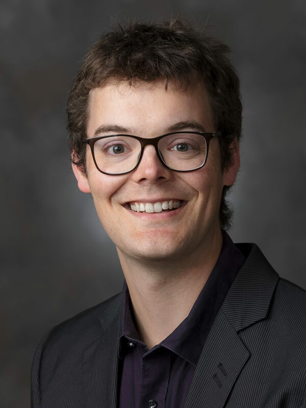

{style="float:right; padding: 10px; object-fit: cover; object-position: top;" fig-alt="Headshot of Dr. Jason Hawkins" height="230" width="200"}

[**Dr. Jason Hawkins**](https://profiles.ucalgary.ca/jason-hawkins) is an Assistant Professor in the Department of Civil Engineering at the University of Calgary. His expertise is in travel behaviour, transportation demand modeling, spatial econometrics, and life-cycle assessment. Dr. Hawkins is a member of the Transportation Research Board (TRB) Traveler Behavior and Values Committee. He is also a board member on the Zephyr Foundation for open transportation analysis. Dr. Hawkins received his Ph.D. from the University of Toronto in 2021, for which he received the Eric Pas Award from the International Association for Travel Behaviour Research (IATBR). He holds M.Sc. (2016) and B.Sc. (2014) degrees in Civil Engineering from the University of Calgary. Dr. Hawkins completed postdoctoral work at the University of Texas at Austin. He was previously an Assistant Professor of Civil and Environmental Engineering at the University of Nebraska–Lincoln (2021–2024).

## Prospective Students

The TECH Group is always looking for curious scholars to conduct transdisciplinary research in methods and empirics related to sustainable infrastructure development and household choice. Funding programs include the NSERC Graduate Programs for Master's and Doctoral students, the SSHRC Joseph-Armand Bombardier Canada Graduate Scholarship, the China Scholarship Council, and other funded opportunities. If you have received funding from these programs (or plan to apply), please send me an email if you are interested in the TECH Group and the University of Calgary. Please also check your eligibility prior to emailing me if you plan to apply.

We are particularly interested in students with transdisciplinary research interests in policy studies or planning. See the [University of Calgary Transdisciplinary Research in Policy Studies](https://transdisciplinary.ucalgary.ca/programs/policy-studies) website for more details.

Undergraduate students at the University of Calgary are encouraged to reach out about research opportunities. Funding is available through [PURE](https://ucalgary.ca/experiential-learning/undergraduate-research).

## Graduate Students

::: {#current-grad}
:::

## Alumni

### Graduate Students and Research Associates

::: {#former-grad}
:::

### Undergraduate Research Assistants

::: {#former-ugrad}
:::

### High School Researchers

::: {#former-hs}
:::
